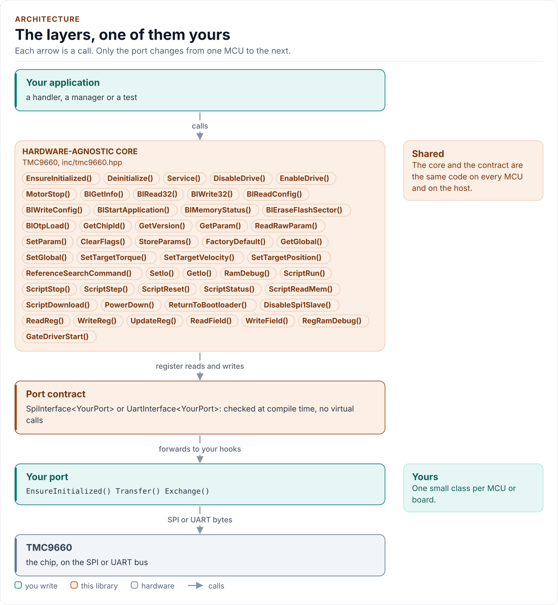
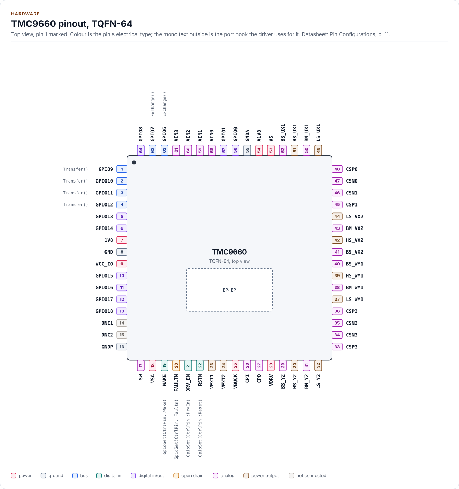
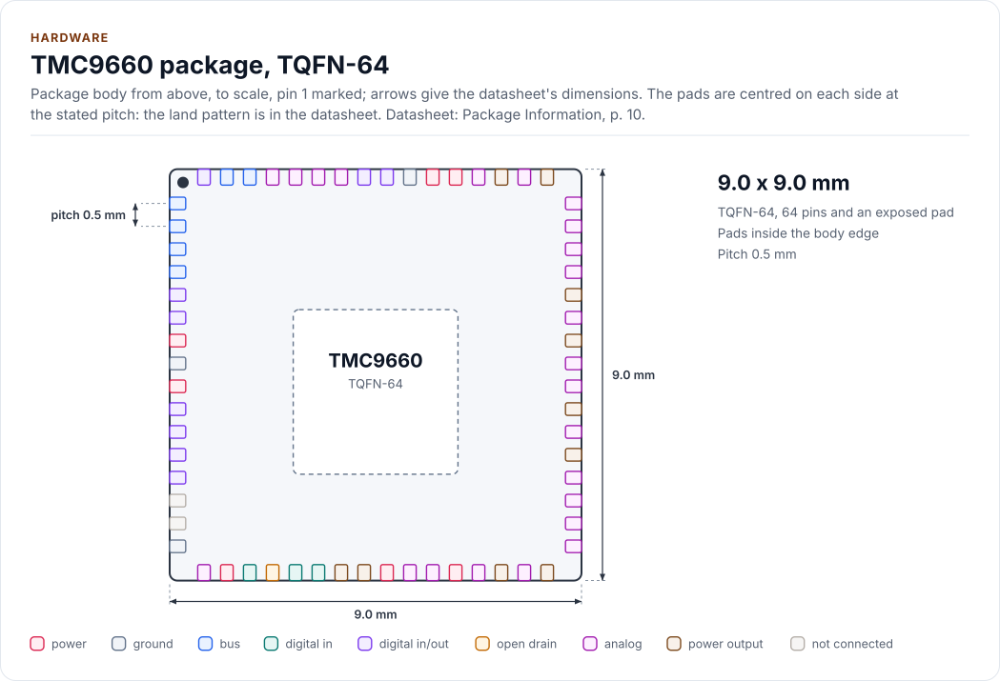
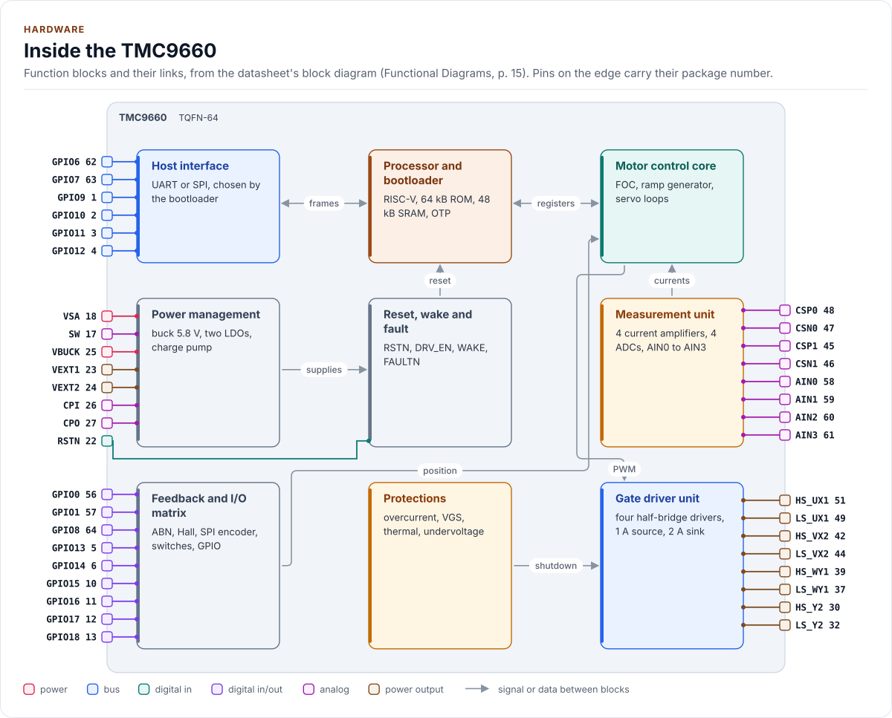

# TMC9660 Driver

C++20 driver for the TMC9660 servo controller and gate driver (bootloader, parameter mode and register mode over SPI or UART)

[](https://github.com/kokeb-labs-drivers/driver-tmc9660/actions/workflows/ci.yml)
[](LICENSE)
[](docs/installation.md#requirements)

**Documentation: [`docs/`](docs/index.md)**, with the API reference built by Doxygen ([how](docs/api-reference.md)).
The site at <https://kokeb-labs-drivers.github.io/driver-tmc9660/> opens when the repository is public.


The TMC9660 is a 70 V smart gate driver with a hardware servo controller (field-oriented control, ramp generator,
position, velocity and torque loops) and a buck converter. An application processor talks to it over SPI or UART, in
one of three protocols: the bootloader, parameter mode (TMCL) and register mode. This driver speaks all three, checks
every value against the reference manuals' tables before it sends a byte, watches for chip resets, and keeps the
power stage off until a guarded call and the chip's own flags say otherwise. It runs on any MCU: you give it a small
class that moves bytes on your bus, and it does the rest.

<!-- figure: driver-layers -->
<picture>
  <source media="(prefers-color-scheme: dark)" srcset="docs/diagrams/driver-layers.dark.svg">
  
</picture>
<!-- /figure -->

## At a glance

| | |
| --- | --- |
| **Chip** | TMC9660, 70 V gate driver with servo controller (FOC) in hardware and buck converter |
| **Modes** | Bootloader, parameter mode (289 parameters, TMCL) and register mode (163 registers) |
| **Bus** | SPI mode 3 up to 10 MHz, or UART with automatic baud detection; one bus per driver object |
| **Drives** | RSTN, DRV_EN and WAKE through optional `GpioSet()`; reads FAULTN through optional `GpioGet()` |
| **Safety** | `EnableDrive()` and `GateDriverStart()` are the only ways on; `DisableDrive()` is never refused ([Safety](docs/safety.md)) |
| **Driver** | Header-only C++20; no heap, exceptions, RTTI or virtual calls; every call returns `Result<T>` |
| **Runs on** | Any MCU with SPI or UART and a C++20 compiler; the host example runs on any PC ([Platforms](docs/platforms.md)) |
| **Status** | 0.1.0, not yet verified on hardware: host-tested against an independent model of the chip |

<!-- figure: chip-pinout -->
<picture>
  <source media="(prefers-color-scheme: dark)" srcset="docs/diagrams/chip-pinout.dark.svg">
  
</picture>
<!-- /figure -->

<!-- figure: chip-outline -->
<picture>
  <source media="(prefers-color-scheme: dark)" srcset="docs/diagrams/chip-outline.dark.svg">
  
</picture>
<!-- /figure -->

<!-- figure: chip-blocks -->
<picture>
  <source media="(prefers-color-scheme: dark)" srcset="docs/diagrams/chip-blocks.dark.svg">
  
</picture>
<!-- /figure -->

<!-- generated: chip-card -->
| | | Datasheet |
| --- | --- | --- |
| **Package** | TQFN-64, exposed pad | Pin Configurations, p. 11 |
| **Pins** | 64 | Pin Configurations, p. 11 |
| **Body size** | 9.0 x 9.0 mm | Package Information, p. 10 |
| **Pin pitch** | 0.5 mm | Package Information, p. 10 |
| **Supply VSA** | 7.7 V to 80.0 V | Power Supply - Electrical Characteristics, p. 17 |
| **Supply VS** | 7.7 V to 70.0 V | Power Supply - Electrical Characteristics, p. 17 |
| **Supply VCC_IO** | 2.5 V to 5.0 V | Power Supply - Electrical Characteristics, p. 17 |

From [`docs/hardware.yml`](docs/hardware.yml); pins, circuits and the block diagram: [Hardware](docs/hardware.md).
<!-- /generated -->

## Datasheet

<!-- generated: datasheet-card -->
| Document | Revision | Get it |
| --- | --- | --- |
| Datasheet: TMC9660 70V Smart Gate Driver with Servo (FOC) Controller in HW and Buck Converter (Analog Devices (Trinamic) 19-101926) | 1, 2024-11 | [vendor page](https://www.analog.com/en/products/tmc9660.html) |
| Datasheet: TMC9660 Parameter Mode Reference Manual (Analog Devices (Trinamic) n/a) | 0, 2025-02 | [vendor page](https://www.analog.com/en/products/tmc9660.html) |
| Datasheet: TMC9660 Register Mode Reference Manual (Analog Devices (Trinamic) n/a) | 0, 2025-04 | [vendor page](https://www.analog.com/en/products/tmc9660.html) |
| Datasheet: TMC9660 Configuration and Bootstrapping (Analog Devices (Trinamic) AN-2601) | 0, 2025-01-08 | [vendor page](https://www.analog.com/en/products/tmc9660.html) |

Written against these revisions; the SHA-256 of each file is in [`docs/datasheets.yml`](docs/datasheets.yml). Where each
part of the driver is in the datasheet: [Datasheet map](docs/datasheet.md).
<!-- /generated -->

Every docs page lists the datasheet sections it relies on, and code comments cite the section they implement.

## Try it on your PC

No hardware needed: [`examples/host`](examples/host/README.md) runs the driver against a simulated chip.
You need git, CMake 3.16+ and a C++20 compiler (GCC 10+, Clang 13+ or MSVC 2022).

1. Get the source:

   ```bash
   git clone https://github.com/kokeb-labs-drivers/driver-tmc9660.git && cd driver-tmc9660
   ```

2. Build and run the example:

   ```bash
   cmake -S examples/host -B build-example
   cmake --build build-example
   ./build-example/tmc9660_host_example
   ```

3. You should see the driver start the simulated chip in its bootloader, start the application in parameter mode, set
   limits, switch the drive on through the guarded call and off again:

   ```text
   TMC9660 driver 0.1.0 on the host
   tmc9660: initialised
   bootloader: chip type 544D0001
   parameter mode: chip type 544D0001
   MAX_TORQUE 70000: InvalidArgument
   drive on, DRV_EN high
   MAX_TORQUE 1500
   drive off, DRV_EN low
   done: 0 errors
   ```

To run the whole test suite instead: `cmake -S . -B build -DTMC9660_BUILD_TESTS=ON && cmake --build build && ctest
--test-dir build`.

## Use it on your MCU

**1. Wire it** ([Hardware](docs/hardware.md) has every pin, the timing and the power). The bootloader listens on the
pins below at power-up; use one bus.

| MCU | TMC9660 | Notes |
| --- | --- | --- |
| SPI SCK | GPIO11 (pin 3) | Mode 3, up to 10 MHz; 1 MHz for bring-up on jumper wires |
| SPI MOSI | GPIO10 (pin 2) | |
| SPI MISO | GPIO9 (pin 1) | Stays driven after chip select rises (erratum 2): no other SPI device on this line |
| GPIO (chip select) | GPIO12 (pin 4) | Low for the whole frame: one transfer per frame |
| GPIO | RSTN (pin 22), DRV_EN (pin 21) | Optional; the driver drives them only through `GpioSet()` |
| 3.3 V | VCC_IO (pin 9) | 2.2 V to 5.5 V; 1 µF to GND close to the pin |
| GND | GND (pin 8) | |

On UART the pins are GPIO6 (TX, pin 62) and GPIO7 (RX, pin 63) of the chip.

**2. Write the port**: a class with `EnsureInitialized()` (bring the bus up), `Transfer()` (one full-duplex frame
with chip select low; on UART, `Exchange()`) and `DelayUs()`, about 20 lines on most SDKs.
[Porting](docs/porting.md) has the contract and a complete example.

**3. Read a parameter:**

<!-- generated: quickstart-code -->
```cpp
#include "tmc9660.hpp"

int read_actual_velocity(MyPort& port, int32_t& velocity) {
  tmc9660::Config config{};
  config.mode =
      tmc9660::Mode::Parameter; // the chip boots into the mode its boot configuration says
  tmc9660::TMC9660<MyPort> chip(port, config); // no I/O yet

  if (auto r = chip.EnsureInitialized(); !r) { // 1. bus up, identity check, first handshake
    return static_cast<int>(r.error); //    Bus, Timeout or DeviceIdMismatch: check wiring and mode
  }
  const auto v =
      chip.GetParam(tmc9660::Param::ACTUAL_VELOCITY); // 2. a checked read of one parameter
  if (!v) {
    return static_cast<int>(v.error); //    UnexpectedReset: the chip restarted, start again
  }
  velocity = static_cast<int32_t>(v.value); // 3. in the unit of the parameter
  return 0;
}
```
<!-- /generated -->

`EnsureInitialized()` is the only call that starts the driver. Every other call returns `Error::NotInitialized`
until it has succeeded, and no call ever starts or resets the chip on its own.

## What it does

- Speaks the bootloader, parameter mode and register mode, over SPI or UART, and refuses a call that belongs to
  another mode before it sends anything.
- Checks every parameter and register access against the reference manuals' tables: access, range, coded values.
- Starts the application safely: a configuration is written word by word, the boot-mode word last, read back, with
  the clock and PLL checked.
- Switches the drive on only through `EnableDrive()` or `GateDriverStart()`, which read the error flags first, and
  off through `DisableDrive()`, which drops DRV_EN before it tells the chip and is never refused.
- Watches each transport for a chip reset and sends no write after one it saw.
- Returns `Result<T>` with an `Error` from every call: no exceptions, no heap, no RTTI, no virtual calls.

## Add it to your project

Pick the row that matches your build; each is a few steps, and [Installation](docs/installation.md) has the
details.

| Your build | Steps below |
| --- | --- |
| Plain CMake: STM32 (CubeMX), RP2040 (Pico SDK), nRF Connect, a host app | [A](#a-cmake-any-mcu) |
| ESP-IDF | [B](#b-esp-idf) |
| An SDK or OS image that installs libraries | [C](#c-installed-package) |

### A. CMake, any MCU

1. Add the driver as a submodule, pinned to the version you chose:

   ```bash
   git submodule add https://github.com/kokeb-labs-drivers/driver-tmc9660.git external/driver-tmc9660
   ```

2. In your `CMakeLists.txt`, after `project()`:

   ```cmake
   add_subdirectory(external/driver-tmc9660)
   target_link_libraries(my_app PRIVATE tmc9660::tmc9660)   # brings the headers and C++20
   ```

3. In your code, `#include "tmc9660.hpp"`, write the port ([Porting](docs/porting.md)) and build. A first build
   that compiles the quickstart above is the check that the driver is wired in.

### B. ESP-IDF

1. Add the driver under your project's `components/`; ESP-IDF finds it there and names it after the folder:

   ```bash
   git submodule add https://github.com/kokeb-labs-drivers/driver-tmc9660.git components/tmc9660
   ```

2. In `main/CMakeLists.txt`, list it: `idf_component_register(SRCS "main.cpp" REQUIRES tmc9660)`.
3. `idf.py menuconfig` now has a **TMC9660 servo controller** menu (mode, device address, boot timeout, reset),
   and `idf.py build` builds the driver with your app. [`examples/esp32`](examples/esp32) is a complete
   project with a port for the board.

### C. Installed package

1. Install it once into a prefix:

   ```bash
   cmake -S external/driver-tmc9660 -B build-tmc9660 && cmake --install build-tmc9660 --prefix /opt/sdk
   ```

2. In your project, with `CMAKE_PREFIX_PATH=/opt/sdk`:

   ```cmake
   find_package(tmc9660 0.1 REQUIRED)
   target_link_libraries(my_app PRIVATE tmc9660::tmc9660)
   ```

The target is `tmc9660::tmc9660` every way, so switching later changes nothing else.

## Documentation

| Page | Read it when you want to |
| --- | --- |
| [Quickstart](docs/quickstart.md) | Go from a bare chip to a parameter read on your MCU |
| [Hardware](docs/hardware.md) | Wire it, check the pins, the bus settings, the timing and the power |
| [Porting](docs/porting.md) | Write the port class for your MCU's SDK, on SPI or UART |
| [API guide](docs/api-guide.md) | Use each call: start, bootloader, parameters, drive, registers, errors |
| [Bootloader](docs/bootloader.md), [Parameter mode](docs/parameter-mode.md), [Register mode](docs/register-mode.md) | The frames and calls of each mode |
| [Safety](docs/safety.md) | What keeps the power stage off and what the driver does not cover |
| [Configuration](docs/configuration.md) | Choose every setting |
| [Ambiguities](docs/ambiguities.md) | Where the documents disagree, the reading chosen and its knob |
| [Troubleshooting](docs/troubleshooting.md) | Find the cause of an error |
| [Contract](docs/contract.md) | Know exactly what the driver promises, needs and returns |
| [Datasheet map](docs/datasheet.md) | Find the document section behind each part of the driver, and the feature coverage |
| [API reference](docs/api-reference.md) | Look up a class or member (Doxygen; built by CI and locally) |

## Tests and quality

```bash
cmake -S . -B build -DTMC9660_BUILD_TESTS=ON && cmake --build build && ctest --test-dir build
```

The host tests run the driver against an independent model of the chip, fail every bus transfer in turn, and produce
each error the driver can return. A fuzzer fails, corrupts and replaces what the chip sends back and checks the
driver's promises after every call; 55 one-edit mutants of the safety guards must each be caught by a test
(`tools/mutants/mutants.py`); the parameter and register tables are generated and format-stable
(`tools/gen_tables`). CI also builds for Cortex-M and gates coverage, complexity, sanitizers, fuzzing, clang-tidy,
cppcheck and the handbook rules (`.kokeb/handbook.yml`). See [Testing and CI](docs/testing.md), which lists every gate
and its limit.

## License

MIT. See [LICENSE](LICENSE).
