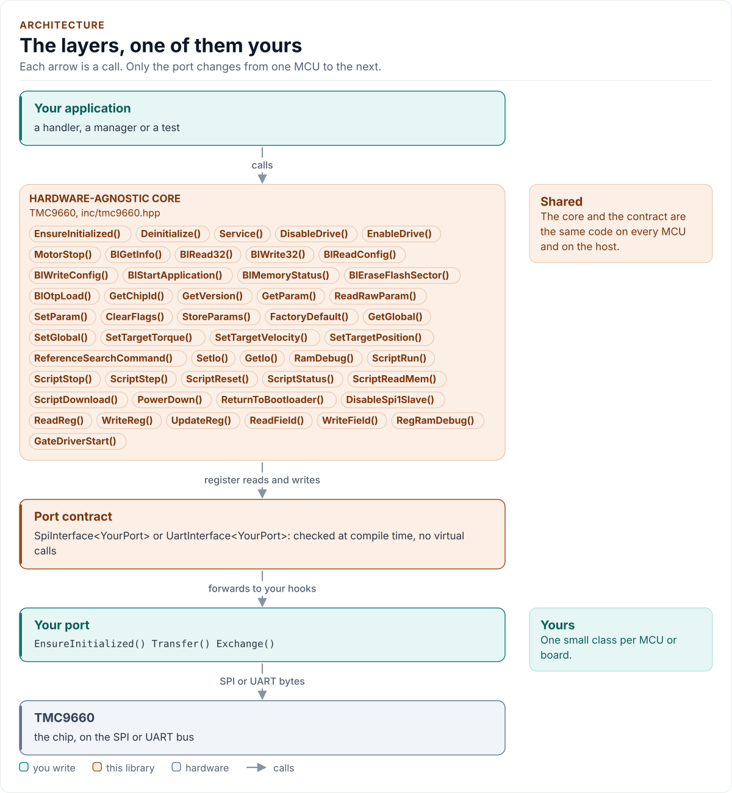

# Architecture

How the driver is built, so you can read the code, add a feature or port it.

<!-- generated: datasheet-refs -->
??? abstract "Datasheet sections this page relies on"

    From Analog Devices (Trinamic) 19-101926 1:

    - Application modes: Application Modes, p. 16

    All of them, with the driver API for each: [Datasheet map](datasheet.md).
<!-- /generated -->

## Layers

<!-- figure: driver-layers -->
<picture>
  <source media="(prefers-color-scheme: dark)" srcset="diagrams/driver-layers.dark.svg">
  
</picture>
<!-- /figure -->

The core, `tmc9660::TMC9660<Port>`, has no platform code. It calls hooks on your port class, which derives from
`SpiInterface<Port>` or from `UartInterface<Port>`. The concept `AnyPort` accepts exactly one of the two, checked at
compile time.

## Files

| File | Contents |
| --- | --- |
| `inc/tmc9660.hpp`, `src/tmc9660.ipp` | The class: lifecycle, the three modes, the safety guards |
| `inc/tmc9660_types.hpp` | `Error`, `Result`, `Mode`, `Config`, `Quirks`, enumerations |
| `inc/tmc9660_frames.hpp` | Pure frame encoders and decoders of all protocols, proved with `static_assert` |
| `inc/tmc9660_bootconfig.hpp` | `BootConfig` and the field table of the configuration memory |
| `inc/tmc9660_params.hpp` | The 289 parameters (generated) |
| `inc/tmc9660_registers.hpp` | The 163 registers and their bit fields (generated) |
| `inc/tmc9660_globals.hpp` | The global parameters of the four banks |
| `inc/tmc9660_spi_interface.hpp`, `inc/tmc9660_uart_interface.hpp` | The port contracts and the bus requirements |
| `inc/tmc9660_kconfig.hpp` | `KconfigDefaults()` for ESP-IDF menuconfig |

The `.ipp` file is included at the end of `tmc9660.hpp`: the driver is header-only.

## One class, three modes

The chip speaks one of three protocols, and which one depends on its boot configuration, so the mode is a run-time
value (`Mode`), not a template parameter. Every public function starts with `need(Mode)`: a call in the wrong mode
returns `WrongMode` before it touches the bus. A change of mode, by `BlStartApplication()`, `BlWriteConfig()` or
`ReturnToBootloader()`, updates `mode_` after the chip identity has been read in the new mode.

## Transport and protocol are separate

Frames are built and parsed by `detail::` functions in `tmc9660_frames.hpp`: no I/O, no state, `constexpr`, each proved
against the documents' worked examples. The class owns the exchange: send the frame, check the reply, track the reset
evidence of that transport (`FIRST_CMD`, the boot bit and datagram counter, the canary), map the result to `Error`.
That is why a protocol detail is a unit test of a pure function and the exchange logic is a test against the chip
model.

## Generated tables

The parameter and register tables are generated from `tools/gen_tables/params.json` and `regs.json`, which were
transcribed from the reference manuals, by `tools/gen_tables/gen_tables.py`. The output is formatted with the
repository's clang-format and a CTest checks that the committed headers equal the generator's output
([Testing](testing.md#generated-tables-and-formatting)).

## The model

`tests/mock_tmc9660.hpp` is an independent model of the chip, written from the documents and not from the driver: it
has the three protocols, the parameter and register tables, memories, reset, and the faults of the chip as switches.
It records what happened to the chip (writes after a reset, energise events with an error flag latched or DRV_EN low,
boot with the drive on) so that a test asserts on the chip, not on the driver's own opinion.
