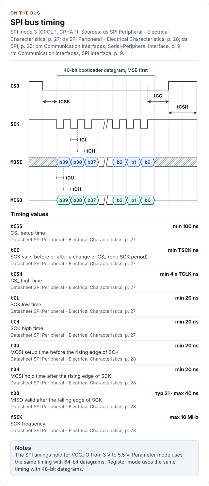
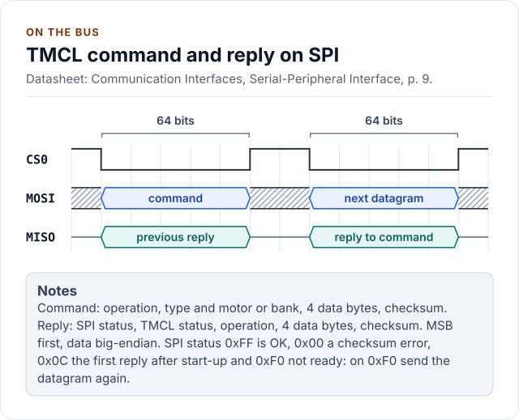
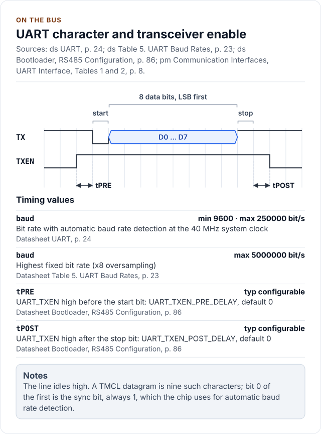
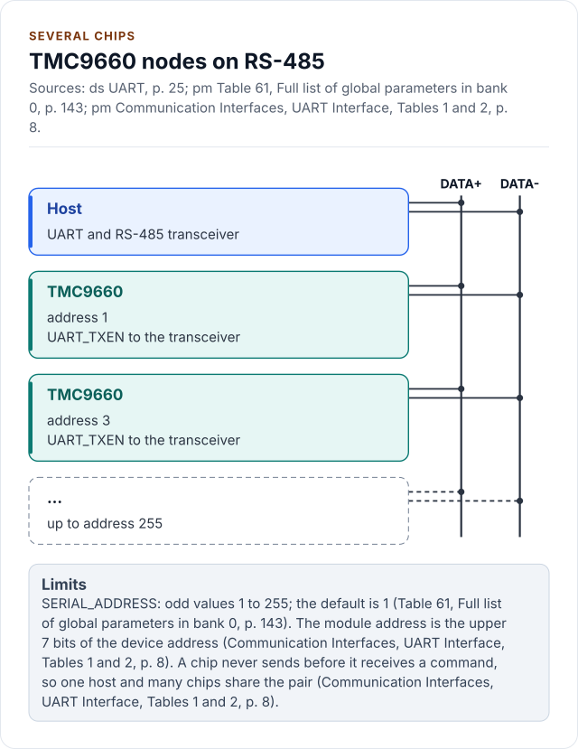

# On the bus

What the TMC9660 needs from its host link, signal by signal, with every time and rate taken from the datasheet and the
two reference manuals. The datagram contents are on the [Parameter mode](parameter-mode.md),
[Register mode](register-mode.md) and [Bootloader](bootloader.md) pages; this page is the waveform under them.

## SPI timing

The TMC9660 is an SPI peripheral in mode 3 on SPI0_CS0, SPI0_SCK, SPI0_MOSI and SPI0_MISO: it reads MOSI on the rising
edge of SCK and shifts MISO out on the falling edge, up to 10 MHz. The bootloader takes 40-bit datagrams, parameter
mode 64-bit and register mode 48-bit ones, all MSB first and all with the same timing.

<!-- figure: spi-timing -->
<picture>
  <source media="(prefers-color-scheme: dark)" srcset="diagrams/spi-timing.dark.svg">
  
</picture>
<!-- /figure -->

In parameter mode every 64-bit datagram returns the reply to the one before it, so a command needs a second datagram
for its reply; while the chip is busy the status says not ready and the datagram is sent again.

<!-- figure: tmcl-spi -->
<picture>
  <source media="(prefers-color-scheme: dark)" srcset="diagrams/tmcl-spi.dark.svg">
  
</picture>
<!-- /figure -->

## UART

The UART is 8N1, least significant bit first, idle high. The chip detects the baud rate on its own from 9600 to
250000 bit/s at its 40 MHz system clock; higher rates up to 5 Mbit/s need a fixed setting. A TMCL datagram is nine
characters in both directions, and the chip only ever answers a command. For an RS-485 transceiver the chip drives
UART_TXEN around its own characters.

<!-- figure: uart-timing -->
<picture>
  <source media="(prefers-color-scheme: dark)" srcset="diagrams/uart-timing.dark.svg">
  
</picture>
<!-- /figure -->

## Several devices

SPI has no daisy chain: each TMC9660 needs its own chip select (the peripheral supports CS0 only). On UART several
chips can share one RS-485 bus: each answers only its own module address, an odd value from 1 to 255.

<!-- figure: uart-topology -->
<picture>
  <source media="(prefers-color-scheme: dark)" srcset="diagrams/uart-topology.dark.svg">
  
</picture>
<!-- /figure -->

## How these figures are made

Each figure is a model in `docs/model/` (`spi-timing.timing.yml`, `tmcl-spi.timing.yml`, `uart-timing.timing.yml` and
`uart-topology.topology.yml`) that cites the document section and page of every number; `kokeb-docs figures` draws it
and the build fails on a number without a citation. The values table under each waveform is also written as
`docs/diagrams/<id>.table.html`.
