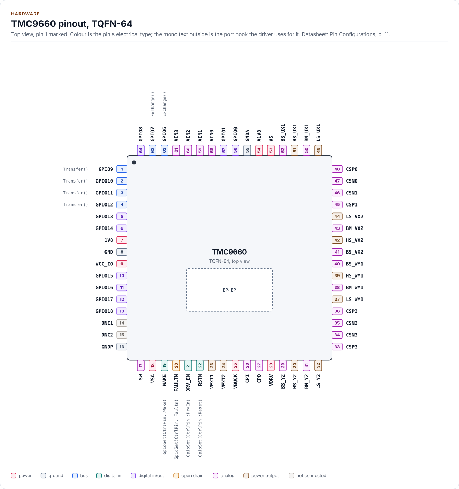
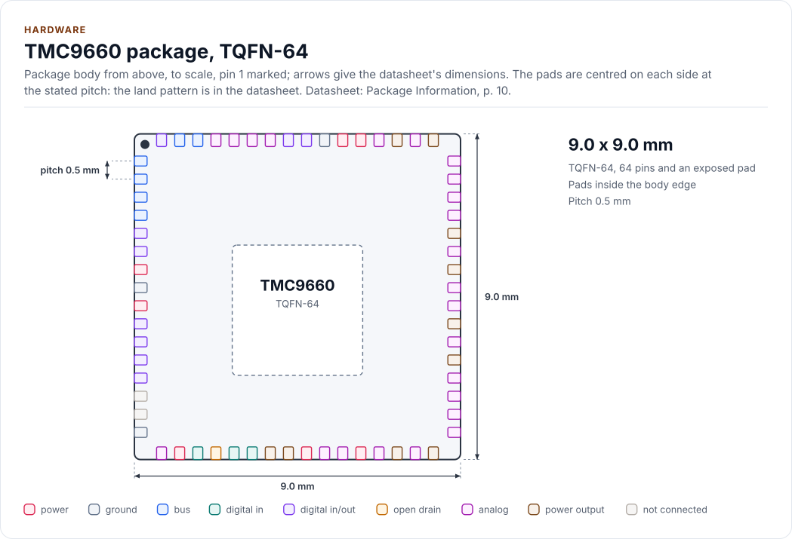
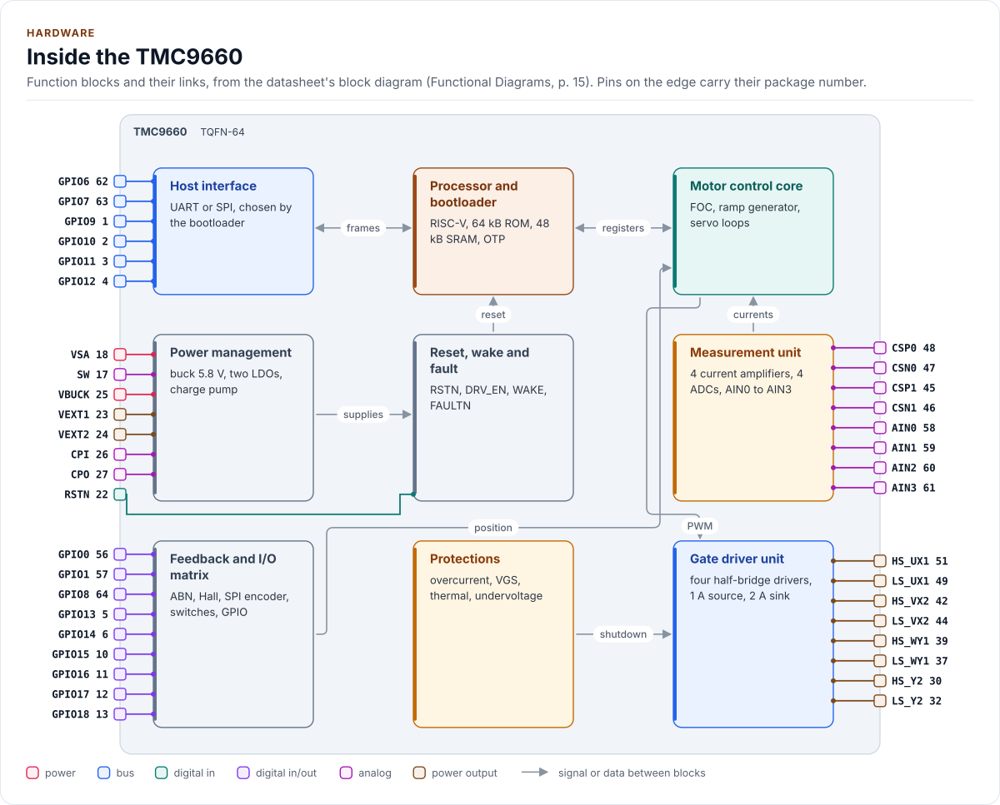
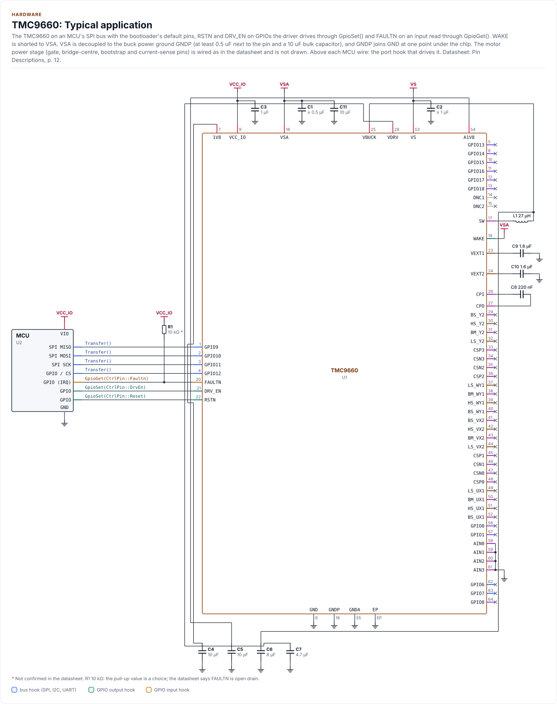

# Hardware

The TMC9660's package, pins, bus settings, timing and power, as the driver uses them. The chip is a 70 V smart gate
driver with a servo controller (FOC) in hardware and a buck converter; the driver talks to its processor over SPI
or UART, never to the power stage directly.

<!-- generated: datasheet-refs -->
??? abstract "Datasheet sections this page relies on"

    From Analog Devices (Trinamic) 19-101926 1:

    - Package, pins and power-up pin functions: Pin Configurations; Pin Descriptions, p. 11
    - Supply ranges and the hibernation mode: Power Supply - Electrical Characteristics, p. 17
    - Pin functions at power-up and the UART and SPI of the bootloader: General-Purpose Input/Output Description, p. 19
    - Clock, reset, DRV_EN, WAKE and FAULTN: Clock and Control Description, p. 63

    All of them, with the driver API for each: [Datasheet map](datasheet.md).
<!-- /generated -->

## Package and pins

The TMC9660 is sold in one package, the 64-pin TQFN (9 x 9 mm, 0.5 mm pitch) with an exposed pad that is GND.
The pin table below is drawn from [`docs/hardware.yml`](hardware.yml), which cites the datasheet for each pin.

<!-- figure: chip-pinout -->
<picture>
  <source media="(prefers-color-scheme: dark)" srcset="diagrams/chip-pinout.dark.svg">
  
</picture>
<!-- /figure -->

<!-- figure: chip-outline -->
<picture>
  <source media="(prefers-color-scheme: dark)" srcset="diagrams/chip-outline.dark.svg">
  
</picture>
<!-- /figure -->

<!-- generated: chip-pins -->
TQFN-64, 64 pins and an exposed pad (Pin Configurations, p. 11).

| Pin | Name | Type (domain) | Function | Driver hook | If unused | Datasheet |
| --- | --- | --- | --- | --- | --- | --- |
| 1 | `GPIO9` | bus (VCC_IO) | GPIO9, or SPI0_MISO after power-up (bootloader SPI, data out) | `Transfer()` | Leave open (internal pull-up) | Pin Descriptions, p. 12 |
| 2 | `GPIO10` | bus (VCC_IO) | GPIO10, or SPI0_MOSI after power-up (bootloader SPI, data in) | `Transfer()` | Leave open (internal pull-up) | Pin Descriptions, p. 12 |
| 3 | `GPIO11` | bus (VCC_IO) | GPIO11, or SPI0_SCK after power-up (bootloader SPI, clock in) | `Transfer()` | Leave open (internal pull-up) | Pin Descriptions, p. 12 |
| 4 | `GPIO12` | bus (VCC_IO) | GPIO12, or SPI0_CS0 after power-up (bootloader SPI, chip select, active low) | `Transfer()` | Leave open (internal pull-up) | Pin Descriptions, p. 12 |
| 5 | `GPIO13` | digital in/out (VCC_IO) | GPIO13 (input with pull-up at power-up) | - | Leave open (internal pull-up) | Pin Descriptions, p. 12 |
| 6 | `GPIO14` | digital in/out (VCC_IO) | GPIO14 (input with pull-up at power-up) | - | Leave open (internal pull-up) | Pin Descriptions, p. 12 |
| 7 | `1V8` | power (1V8) | Digital core supply input; 10 uF to GND | - | - | Pin Descriptions, p. 12 |
| 8 | `GND` | ground | Ground | - | - | Pin Descriptions, p. 12 |
| 9 | `VCC_IO` | power (VCC_IO) | Logic supply input, 2.5 V to 5 V (3 V or more for SPI at 10 MHz); 1 uF to GND | - | - | Pin Descriptions, p. 12 |
| 10 | `GPIO15` | digital in/out (VCC_IO) | GPIO15 (input with pull-up at power-up) | - | Leave open (internal pull-up) | Pin Descriptions, p. 12 |
| 11 | `GPIO16` | digital in/out (VCC_IO) | GPIO16 (input with pull-up at power-up) | - | Leave open (internal pull-up) | Pin Descriptions, p. 12 |
| 12 | `GPIO17` | digital in/out (VCC_IO) | GPIO17 (input with pull-up at power-up) | - | Leave open (internal pull-up) | Pin Descriptions, p. 12 |
| 13 | `GPIO18` | digital in/out (VCC_IO) | GPIO18 (input with pull-up at power-up) | - | Leave open (internal pull-up) | Pin Descriptions, p. 12 |
| 14 | `DNC1` | not connected | Do not connect, internally connected (the datasheet names it DNC) | - | Do not connect | Pin Descriptions, p. 12 |
| 15 | `DNC2` | not connected | Do not connect, internally connected, or tie to GND (the datasheet names it DNC) | - | Do not connect, or tie to GND | Pin Descriptions, p. 12 |
| 16 | `GNDP` | ground | Buck power ground | - | - | Pin Descriptions, p. 12 |
| 17 | `SW` | analog (VSA) | Buck switching output; inductor to VBUCK | - | - | Pin Descriptions, p. 12 |
| 18 | `VSA` | power (VSA) | Core and buck supply input, 7.7 V to 80 V; at least 0.5 uF and a 10 uF bulk capacitor to GNDP | - | - | Pin Descriptions, p. 12 |
| 19 | `WAKE` | digital in (VSA) | Drive high to power up and to leave hibernation; may be shorted to VSA | `GpioSet(CtrlPin::Wake)` | Short to VSA, or pull down | Pin Descriptions, p. 12 |
| 20 | `FAULTN` | open drain (VCC_IO) | Fault output, open drain: busy while bootstrapping, or a severe error | `GpioGet(CtrlPin::Faultn)` | Leave open | Pin Descriptions, p. 12 |
| 21 | `DRV_EN` | digital in (VCC_IO) | Driver enable, active high, internal pull-down | `GpioSet(CtrlPin::DrvEn)` | - | Pin Descriptions, p. 12 |
| 22 | `RSTN` | digital in (VCC_IO) | System reset, active low, internal pull-down | `GpioSet(CtrlPin::Reset)` | - | Pin Descriptions, p. 12 |
| 23 | `VEXT1` | power output (VEXT1) | Configurable 5.0 V, 3.3 V or 2.5 V supply output for external circuits; 1.6 uF to GND | - | Leave open | Pin Descriptions, p. 12 |
| 24 | `VEXT2` | power output (VEXT2) | Configurable 5.0 V, 3.3 V or 2.5 V supply output for external circuits; 1.6 uF to GND | - | Leave open | Pin Descriptions, p. 12 |
| 25 | `VBUCK` | power (VBUCK) | Buck output, charge pump and LDO supply input | - | - | Pin Descriptions, p. 12 |
| 26 | `CPI` | analog (VBUCK) | Charge pump fly capacitor, low-voltage side | - | - | Pin Descriptions, p. 12 |
| 27 | `CPO` | analog (VDRV) | Charge pump fly capacitor, high-voltage side | - | - | Pin Descriptions, p. 12 |
| 28 | `VDRV` | power (VDRV) | Charge pump output, gate driver supply; OTP programming voltage input | - | - | Pin Descriptions, p. 12 |
| 29 | `BS_Y2` | analog (VDRV) | Bootstrap capacitor, phase Y2 (tie to VDRV when HS_Y2 drives a low-side gate) | - | - | Pin Descriptions, p. 12 |
| 30 | `HS_Y2` | power output (VDRV) | High-side gate driver output, phase Y2 | - | - | Pin Descriptions, p. 12 |
| 31 | `BM_Y2` | analog (VDRV) | High-side source and driver return, phase Y2 (tie to GND when HS_Y2 drives a low-side gate) | - | - | Pin Descriptions, p. 12 |
| 32 | `LS_Y2` | power output (VDRV) | Low-side gate driver output, phase Y2 | - | - | Pin Descriptions, p. 12 |
| 33 | `CSP3` | analog (VDRV) | Current-sense amplifier 3, positive input; low-side driver return | - | - | Pin Descriptions, p. 12 |
| 34 | `CSN3` | analog (VDRV) | Current-sense amplifier 3, negative input | - | - | Pin Descriptions, p. 12 |
| 35 | `CSN2` | analog (VDRV) | Current-sense amplifier 2, negative input | - | - | Pin Descriptions, p. 12 |
| 36 | `CSP2` | analog (VDRV) | Current-sense amplifier 2, positive input; low-side driver return | - | - | Pin Descriptions, p. 12 |
| 37 | `LS_WY1` | power output (VDRV) | Low-side gate driver output, phase W/Y1 | - | - | Pin Descriptions, p. 12 |
| 38 | `BM_WY1` | analog (VDRV) | High-side source and driver return, phase W/Y1 | - | - | Pin Descriptions, p. 12 |
| 39 | `HS_WY1` | power output (VDRV) | High-side gate driver output, phase W/Y1 | - | - | Pin Descriptions, p. 12 |
| 40 | `BS_WY1` | analog (VDRV) | Bootstrap capacitor, phase W/Y1 | - | - | Pin Descriptions, p. 12 |
| 41 | `BS_VX2` | analog (VDRV) | Bootstrap capacitor, phase V/X2 | - | - | Pin Descriptions, p. 12 |
| 42 | `HS_VX2` | power output (VDRV) | High-side gate driver output, phase V/X2 | - | - | Pin Descriptions, p. 12 |
| 43 | `BM_VX2` | analog (VDRV) | High-side source and driver return, phase V/X2 | - | - | Pin Descriptions, p. 12 |
| 44 | `LS_VX2` | power output (VDRV) | Low-side gate driver output, phase V/X2 | - | - | Pin Descriptions, p. 12 |
| 45 | `CSP1` | analog (VDRV) | Current-sense amplifier 1, positive input; low-side driver return | - | - | Pin Descriptions, p. 12 |
| 46 | `CSN1` | analog (VDRV) | Current-sense amplifier 1, negative input | - | - | Pin Descriptions, p. 12 |
| 47 | `CSN0` | analog (VDRV) | Current-sense amplifier 0, negative input | - | - | Pin Descriptions, p. 12 |
| 48 | `CSP0` | analog (VDRV) | Current-sense amplifier 0, positive input; low-side driver return | - | - | Pin Descriptions, p. 12 |
| 49 | `LS_UX1` | power output (VDRV) | Low-side gate driver output, phase U/X1 | - | - | Pin Descriptions, p. 12 |
| 50 | `BM_UX1` | analog (VDRV) | High-side source and driver return, phase U/X1 | - | - | Pin Descriptions, p. 12 |
| 51 | `HS_UX1` | power output (VDRV) | High-side gate driver output, phase U/X1 | - | - | Pin Descriptions, p. 12 |
| 52 | `BS_UX1` | analog (VDRV) | Bootstrap capacitor, phase U/X1 | - | - | Pin Descriptions, p. 12 |
| 53 | `VS` | power (VS) | Gate driver supply input, 7.7 V to 70 V; at least 1 uF to GND | - | - | Pin Descriptions, p. 12 |
| 54 | `A1V8` | power (A1V8) | Analog core supply input; 10 uF to GND | - | - | Pin Descriptions, p. 12 |
| 55 | `GNDA` | ground | Analog ground | - | - | Pin Descriptions, p. 12 |
| 56 | `GPIO0` | digital in/out (VCC_IO) | GPIO0 (input with pull-down at power-up) | - | Leave open (internal pull-down) | Pin Descriptions, p. 12 |
| 57 | `GPIO1` | digital in/out (VCC_IO) | GPIO1 (input with pull-down at power-up) | - | Leave open (internal pull-down) | Pin Descriptions, p. 12 |
| 58 | `AIN0` | analog (VCC_IO) | Analog input 0 (high impedance at power-up) | - | Connect to a defined level, for example GND | Pin Descriptions, p. 12 |
| 59 | `AIN1` | analog (VCC_IO) | Analog input 1 (high impedance at power-up) | - | Connect to a defined level, for example GND | Pin Descriptions, p. 12 |
| 60 | `AIN2` | analog (VCC_IO) | Analog input 2 (high impedance at power-up) | - | Connect to a defined level, for example GND | Pin Descriptions, p. 12 |
| 61 | `AIN3` | analog (VCC_IO) | Analog input 3 (high impedance at power-up); parameter mode reads an external temperature sensor here | - | Connect to a defined level, for example GND | Pin Descriptions, p. 12 |
| 62 | `GPIO6` | bus (VCC_IO) | GPIO6, or UART_TX after power-up (bootloader UART, data out) | `Exchange()` | Leave open (internal pull-up) | Pin Descriptions, p. 12 |
| 63 | `GPIO7` | bus (VCC_IO) | GPIO7, or UART_RX after power-up (bootloader UART, data in) | `Exchange()` | Leave open (internal pull-up) | Pin Descriptions, p. 12 |
| 64 | `GPIO8` | digital in/out (VCC_IO) | GPIO8 (input with pull-up at power-up) | - | Leave open (internal pull-up) | Pin Descriptions, p. 12 |
| EP | `EP` | ground | Exposed pad, connected to GND | - | - | Pin Configurations, p. 11 |

Source of this table and of the chip figures: [`docs/hardware.yml`](hardware.yml).
<!-- /generated -->

## Block diagram

<!-- figure: chip-blocks -->
<picture>
  <source media="(prefers-color-scheme: dark)" srcset="diagrams/chip-blocks.dark.svg">
  
</picture>
<!-- /figure -->

## Reference circuit

<!-- figure: chip-circuit-typical -->
<picture>
  <source media="(prefers-color-scheme: dark)" srcset="diagrams/chip-circuit-typical.dark.svg">
  
</picture>
<!-- /figure -->

<!-- generated: chip-parts -->
| Part | Kind | Value | Connects | Datasheet |
| --- | --- | --- | --- | --- |
| U2 | MCU | - | VIO: VCC_IO, GND: GND, SCK: SPI0_SCK, MOSI: SPI0_MOSI, MISO: SPI0_MISO, CS: SPI0_CS0, RST: RSTN, DRVEN: DRV_EN, FLT: FAULTN | Pin Descriptions, p. 12 |
| C1 | capacitor | ≥ 0.5 µF | VSA, GNDP | Pin Descriptions, p. 12 |
| C11 | capacitor | 10 µF | VSA, GNDP | Pin Descriptions, p. 12 |
| C2 | capacitor | ≥ 1 µF | VS, GND | Pin Descriptions, p. 12 |
| C3 | capacitor | 1 µF | VCC_IO, GND | Pin Descriptions, p. 12 |
| C4 | capacitor | 10 µF | 1V8, GND | Pin Descriptions, p. 12 |
| C5 | capacitor | 10 µF | A1V8, GND | Pin Descriptions, p. 12 |
| C6 | capacitor | 8 µF | GND, VBUCK | Power Supply - Electrical Characteristics, p. 17 |
| C7 | capacitor | 4.7 µF | GND, VDRV | Power Supply - Electrical Characteristics, p. 17 |
| C8 | capacitor | 220 nF | CPI, CPO | Power Supply - Electrical Characteristics, p. 17 |
| C9 | capacitor | 1.6 µF | GND, VEXT1 | Pin Descriptions, p. 12 |
| C10 | capacitor | 1.6 µF | GND, VEXT2 | Pin Descriptions, p. 12 |
| L1 | inductor | 27 µH | SW, VBUCK | Power Supply - Electrical Characteristics, p. 17 |
| R1 | resistor | 10 kΩ (not confirmed: the pull-up value is a choice; the datasheet says FAULTN is open drain) | VCC_IO, FAULTN | Pin Descriptions, p. 12 |

Export a circuit for a schematic or PCB tool: `kokeb-docs hardware --kicad-netlist OUT.net --circuit typical`.
<!-- /generated -->

## Which pins carry the host link

At power-up the bootloader selects the interface from the first valid command it sees on either bus, and the pin
functions below replace the plain GPIO functions of the same pins (datasheet, General-Purpose Input/Output
Description). A boot configuration written with `BlWriteConfig()` can move them.

| Interface | Pins | Notes |
| --- | --- | --- |
| UART | GPIO6 (pin 62) is UART_TX, GPIO7 (pin 63) is UART_RX | The bootloader detects the baud rate from the first byte, `0x55` |
| SPI | GPIO9 (pin 1) MISO, GPIO10 (pin 2) MOSI, GPIO11 (pin 3) SCK, GPIO12 (pin 4) CS0 | Mode 3, up to 10 MHz, 40-bit bootloader datagrams |

The driver is built for one bus per object: a port derives from `SpiInterface` or from `UartInterface`, never both
(a compile-time check, `tests/compile_fail/both_buses.cpp`).

## Control pins

The driver drives the control pins only through the optional `GpioSet()` and `GpioGet()` hooks of your port, with
logical levels; the port maps a level to the physical polarity.

| Pin | Hook | Meaning of the logical level |
| --- | --- | --- |
| RSTN (22) | `GpioSet(CtrlPin::Reset, ...)` | `ACTIVE` holds the chip in reset (the pin is low). Used when `Config::hardware_reset` is set |
| DRV_EN (21) | `GpioSet(CtrlPin::DrvEn, ...)` | `ACTIVE` allows the gate driver outputs (the pin is high) |
| WAKE (19) | `GpioSet(CtrlPin::Wake, ...)` | `ACTIVE` asserts the wake condition; only your own power-down logic uses it |
| FAULTN (20) | `GpioGet(CtrlPin::Faultn, high)` | An input: `high` false means the chip pulls the pin low. `Service()` reads it |

A board that wires DRV_EN high or RSTN to a supervisor leaves `GpioSet()` out. The driver then cannot drop DRV_EN in
`DisableDrive()`; the chip-side stop (COMMUTATION_MODE 0, or zero enables in register mode) still runs, and the
call never fails because the pin hook is missing. `Config::hardware_reset` without `GpioSet()` returns
`Error::Unsupported` from `EnsureInitialized()`.

FAULTN is open drain. In the bootloader it signals that the chip is busy bootstrapping or that a severe error
stopped the processor (datasheet, Bootloader FAULTN Signaling). In an application it can also pulse when the chip
restarts; `Config::faultn_is_reset` makes `Service()` treat a low level as a reset (ambiguity A18 in
[Ambiguities](ambiguities.md)).

## Bus settings

| Setting | Bootloader SPI | TMCL SPI | Register-mode SPI | UART (all three) |
| --- | --- | --- | --- | --- |
| Mode | 3 | 3 | 3 | 8N1 |
| Clock | Up to 10 MHz | Up to 10 MHz | Up to 10 MHz | Autobaud after `0x55`; 115200 is a safe start |
| Bit order | MSB first | MSB first | MSB first | LSB first, standard UART |
| Frame | 5 bytes | 8 bytes, two transfers | 6 bytes | 8 bytes (bootloader), 9 bytes (TMCL, register) |
| Chip select | Low for each frame | Low for each frame | Low for each frame | - |

Every SPI exchange is one `Transfer()` call with chip select low for the whole frame. The TMCL SPI reply arrives in
the transfer after the command, so a command costs two transfers (see [Parameter mode](parameter-mode.md)).

!!! warning "The MISO line stays driven after chip select rises (erratum 2)"

    The TMC9660's SPI peripheral does not return MISO to high impedance when chip select is released. With other
    SPI devices on the same MISO line, hold the chip in reset during their transfers or add the switch the
    datasheet shows (Errata, Erratum 2). The driver cannot detect this, and `GpioSet(CtrlPin::Reset, ...)` is the
    hook for the first workaround.

## Timing

| Parameter | Value | Driver |
| --- | --- | --- |
| Power-up or wake to a ready application, self-test on | 44 ms typical | `Config::boot_timeout_ms` (500 ms: the datasheet gives a typical value only, A9) |
| Same, self-test off | 10.5 ms typical | The same wait |
| Wait after a write that reconfigures the chip | not specified | `Config::settle_us` (20 ms, A13) |
| Gap between a TMCL SPI command and its reply request | not specified | `Config::spi_gap_us` (1 ms) |
| UART reply wait | not specified | `Config::reply_timeout_us` (50 ms) |

The driver waits with your port's `DelayUs()`; nothing in it sleeps or spins on a clock of its own.

## Power

| Rail | Range | Note |
| --- | --- | --- |
| VSA | 7.7 V to 80 V | Core and buck supply; the WAKE pin may be shorted to it |
| VS | 7.7 V to 70 V | Gate driver supply |
| VCC_IO | 2.5 V to 5 V (3 V or more for SPI at 10 MHz) | Logic levels of the GPIO and of the host link |
| VEXT1, VEXT2 | 5.0 V, 3.3 V or 2.5 V | Outputs, set in the boot configuration; `BlWriteConfig()` refuses to change them unless `allow_ldo_change` is set, because both move at once |

Hibernation (`PowerDown()`) puts everything but the always-on block into reset; the chip restarts after the time
given or on a rising edge at WAKE, and the driver reports itself uninitialised until `EnsureInitialized()` runs
again.

## Reference documents

Every pin, setting and timing on this page cites a document in [`docs/datasheets.yml`](datasheets.yml); the driver
never contains a vendor PDF, only the revision, date and SHA-256 of the file it was written against.

<!-- generated: datasheet-card -->
| Document | Revision | Get it |
| --- | --- | --- |
| Datasheet: TMC9660 70V Smart Gate Driver with Servo (FOC) Controller in HW and Buck Converter (Analog Devices (Trinamic) 19-101926) | 1, 2024-11 | [vendor page](https://www.analog.com/en/products/tmc9660.html) |
| Datasheet: TMC9660 Parameter Mode Reference Manual (Analog Devices (Trinamic) n/a) | 0, 2025-02 | [vendor page](https://www.analog.com/en/products/tmc9660.html) |
| Datasheet: TMC9660 Register Mode Reference Manual (Analog Devices (Trinamic) n/a) | 0, 2025-04 | [vendor page](https://www.analog.com/en/products/tmc9660.html) |
| Datasheet: TMC9660 Configuration and Bootstrapping (Analog Devices (Trinamic) AN-2601) | 0, 2025-01-08 | [vendor page](https://www.analog.com/en/products/tmc9660.html) |

Written against these revisions; the SHA-256 of each file is in [`docs/datasheets.yml`](datasheets.yml). Where each part
of the driver is in the datasheet: [Datasheet map](datasheet.md).
<!-- /generated -->

| Also useful | Contents |
| --- | --- |
| [`inc/tmc9660_registers.hpp`](../inc/tmc9660_registers.hpp) | The 163 registers of register mode, generated from the Register Mode Reference Manual |
| [`inc/tmc9660_params.hpp`](../inc/tmc9660_params.hpp) | The 289 parameters of parameter mode, generated from Table 57 of the Parameter Mode Reference Manual |
