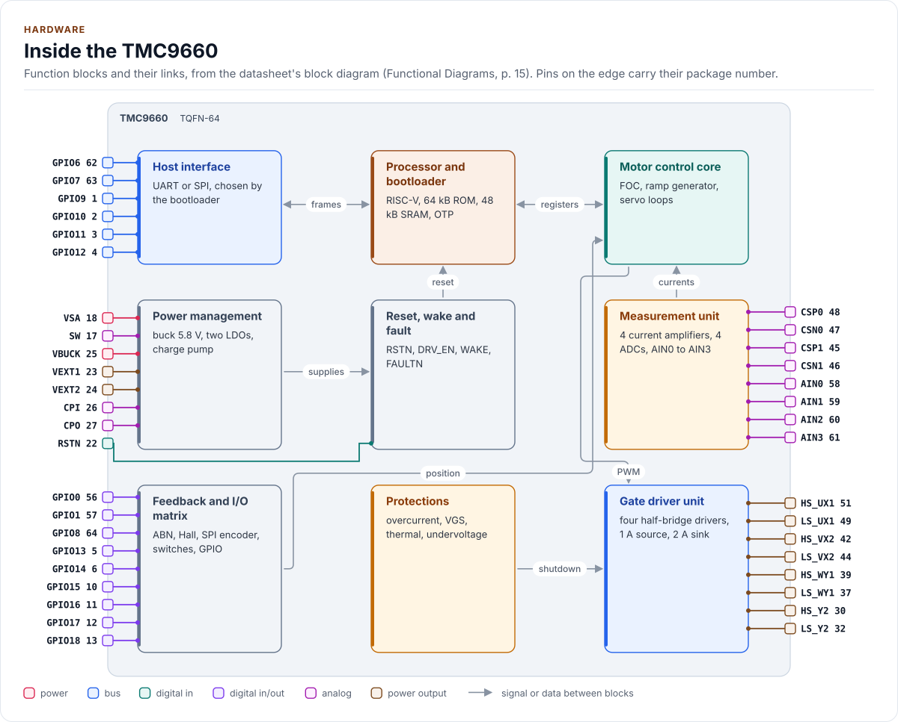
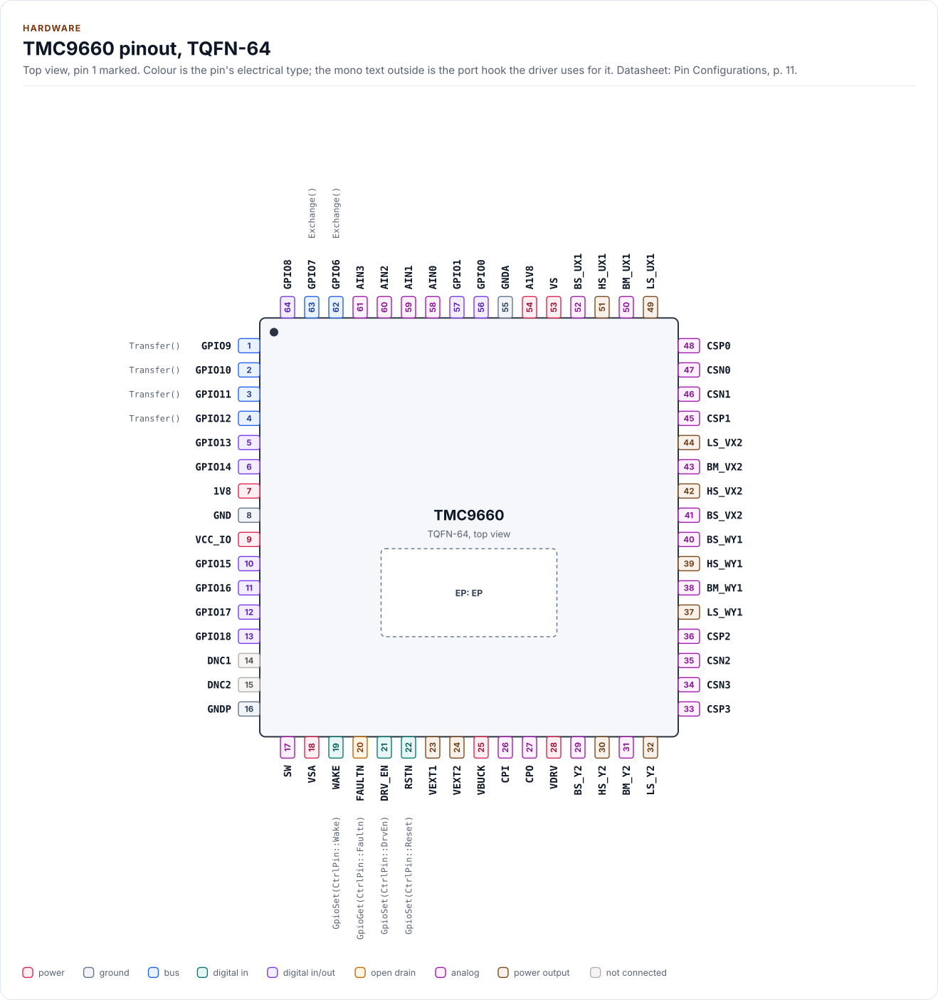
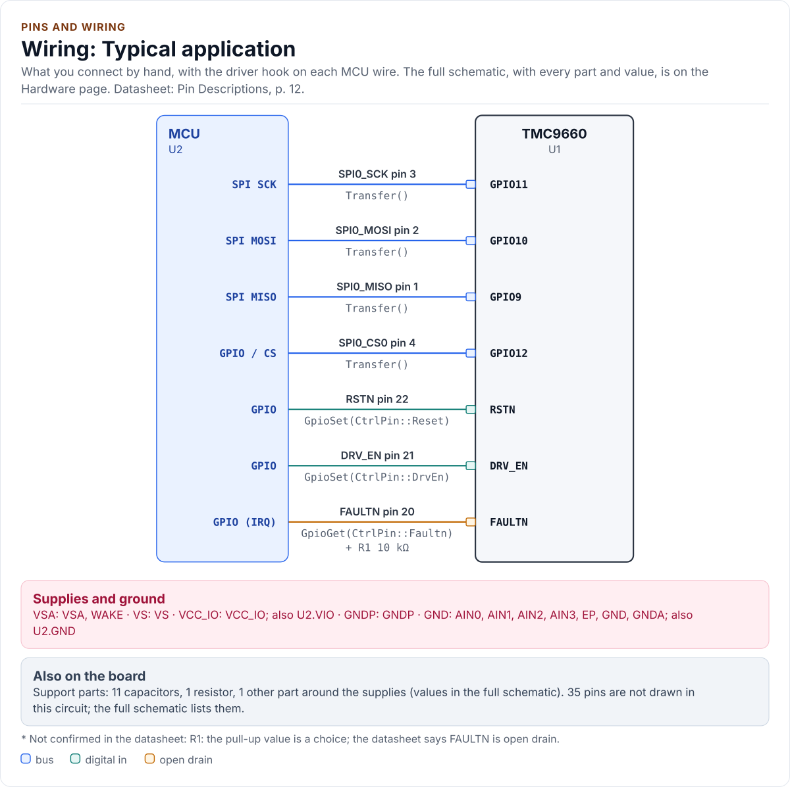
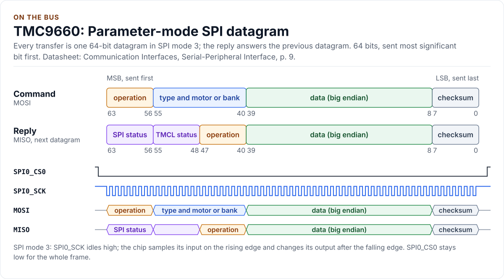

---
hide:
  - navigation
  - toc
---

<div class="kb-hero" markdown>
<span class="kb-kicker">Smart gate driver with servo controller</span>

# TMC9660 Driver

<p>A C++20 driver for the TMC9660 servo controller and gate driver: the bootloader, parameter mode and register mode,
over SPI or UART, with guards so that nothing energises a motor by accident. It runs on any MCU.</p>

[Quickstart](quickstart.md){ .md-button .md-button--primary }
[API guide](api-guide.md){ .md-button }
[Source on GitHub](https://github.com/kokeb-labs-drivers/driver-tmc9660){ .md-button }
</div>

<!-- generated: chip-summary -->
The **TMC9660** is a gate driver and motor controller for BLDC, PMSM, stepper and brushed DC motors: field-oriented
control, the servo loops and a ramp generator run in hardware, and a buck converter powers the chip from the motor
supply (General Description, p. 1).
<!-- /generated -->

<!-- figure: chip-hero -->
<picture>
  <source media="(prefers-color-scheme: dark)" srcset="diagrams/chip-hero.dark.svg">
  
</picture>
<!-- /figure -->

## What it does

<!-- figure: chip-capabilities -->
<picture>
  <source media="(prefers-color-scheme: dark)" srcset="diagrams/chip-capabilities.dark.svg">
  
</picture>
<!-- /figure -->

## Where it is used

<!-- generated: chip-uses -->
- Robotics
- Power tools
- Gardening equipment
- Automated guided vehicles and warehouse automation
- Pumps, such as peristaltic pumps
- Industrial 3D printing
- Factory automation
- Desktop manufacturing
- E-bikes and light electric vehicles

Uses named by the datasheet (General Description, p. 1).
<!-- /generated -->

## Inside the chip

<!-- figure: chip-blocks -->
<picture>
  <source media="(prefers-color-scheme: dark)" srcset="diagrams/chip-blocks.dark.svg">
  
</picture>
<!-- /figure -->

## Pins and wiring

<!-- figure: chip-pinout -->
<picture>
  <source media="(prefers-color-scheme: dark)" srcset="diagrams/chip-pinout.dark.svg">
  
</picture>
<!-- /figure -->

<!-- figure: chip-wiring-typical -->
<picture>
  <source media="(prefers-color-scheme: dark)" srcset="diagrams/chip-wiring-typical.dark.svg">
  
</picture>
<!-- /figure -->

<!-- figure: chip-frame-tmcl-spi -->
<picture>
  <source media="(prefers-color-scheme: dark)" srcset="diagrams/chip-frame-tmcl-spi.dark.svg">
  
</picture>
<!-- /figure -->

Every pin, the UART pins, the bus settings, the timing and the power: [Hardware](hardware.md).

## Quick start

Wire the chip as above, write the port ([Porting](porting.md)), then read a parameter:

```cpp
--8<-- "tests/docs/quickstart.cpp:quickstart"
```

The steps explained: [Quickstart](quickstart.md).

## Driver coverage

<!-- generated: chip-coverage -->
| Capability | What the chip does | Driver API | Registers | Status | Datasheet |
| --- | --- | --- | --- | --- | --- |
| [FOC and servo loops](parameter-mode.md) | Runs field-oriented current control and the torque, velocity and position loops in hardware | `SetTargetTorque`, `SetTargetVelocity`, `SetTargetPosition`, `MotorStop` | `TARGET_TORQUE`, `TARGET_VELOCITY`, `TARGET_POSITION`, `MCC_PID_CONFIG` | Supported | Motor Control Core Description, Field-Oriented Control, p. 29 |
| [Ramp generator and homing](parameter-mode.md) | Plans eight-point acceleration ramps in real time and searches the reference switches for home | `SetParam`, `ReferenceSearchCommand` | `RAMP_ENABLE`, `RAMP_VMAX`, `RAMP_AMAX`, `REFERENCE_SWITCH_SEARCH_MODE`, `MCC_RAMPER_SWITCH_MODE` | Supported | Motor Control Core Description, Ramp Generator, p. 31 |
| [Position feedback](parameter-mode.md) | Reads Hall sensors, ABN encoders or an SPI encoder for commutation and position | `GetParam`, `SetParam` | `HALL_PHI_E`, `ABN_1_STEPS`, `SPI_ENCODER_TRANSFER`, `MCC_HALL_MODE`, `MCC_ABN_MODE` | Supported | Motor Control Core Description, Encoder Feedback, p. 32 |
| [Smart gate driver](safety.md) | Drives up to four NMOS half-bridges, 1 A source and 2 A sink (switched on only after the fault flags read clear) | `EnableDrive`, `GateDriverStart`, `DisableDrive` | `COMMUTATION_MODE`, `UVW_SOURCE_CURRENT`, `MCC_GDRV_HW`, `MCC_GDRV_CFG` | Supported | Gate Driver Unit Description, p. 41 |
| [Current sensing and measurement](parameter-mode.md) | Amplifies the bottom-shunt currents and measures the supply voltage and the temperatures | `GetParam`, `SetParam` | `CSA_GAIN_ADC_I0_TO_ADC_I2`, `ADC_I0`, `SUPPLY_VOLTAGE`, `CHIP_TEMPERATURE`, `MCC_ADC_I1_I0_RAW` | Supported | Measurement Unit Description, p. 50 |
| [Protections](safety.md) | Overcurrent, gate-short, undervoltage and thermal protection; the flags are read before every start | `ClearFlags`, `Service`, `GetParam` | `GENERAL_ERROR_FLAGS`, `GDRV_ERROR_FLAGS`, `MCC_GDRV_FAULT`, `MCC_GDRV_PROT` | Supported | Protections Description, p. 56 |
| [Bootloader and application modes](bootloader.md) | Sets up pins, clock and LDOs at power-up, then starts parameter mode (TMCL) or register mode | `BlGetInfo`, `BlWriteConfig`, `BlStartApplication`, `GetParam`, `SetParam`, `ReadReg`, `WriteReg` | - | Supported | Bootloader, p. 68 |
| [Hibernation and wake-up](safety.md) | Switches all but the always-on block off; the WAKE pin or a timer powers the chip up again (the drive is switched off first) | `PowerDown`, `CtrlPin::Wake` | - | Supported | Power-Saving Modes, p. 16 |
| [OTP configuration](bootloader.md) | Stores the boot configuration permanently; the driver loads it and never burns it | `BlOtpLoad` | - | Not covered | Bootloader, OTP Memory, p. 76 |

**Supported**: the driver covers it and a host test checks it; **Not covered**: the chip has it and the driver leaves it
alone.

From [`docs/hardware.yml`](hardware.yml); `kokeb-docs hardware --check` confirms that every API name is in
`inc/tmc9660.hpp`, `inc/tmc9660_types.hpp` and every register in `inc/tmc9660_params.hpp`, `inc/tmc9660_registers.hpp`.
<!-- /generated -->

The driver has no platform code. You give it a small class that brings the bus up and moves bytes; it does the
rest: the frames of three protocols, the checks of every reply, the parameter and register tables, and the rules
that keep the power stage off until the chip and your request say otherwise.

- **Three modes in one class.** `Mode::Bootloader`, `Mode::Parameter` and `Mode::Register`; a call that belongs to
  another mode returns `WrongMode` and sends nothing. See [Bootloader](bootloader.md),
  [Parameter mode](parameter-mode.md) and [Register mode](register-mode.md).
- **Checked tables.** All 289 parameters and 163 registers of the reference manuals, with access, range and coded
  values; a bad value is refused before a byte leaves.
- **Safe to start and to stop.** `EnableDrive()` reads the flags and raises DRV_EN before it sets the commutation mode;
  `DisableDrive()` is never refused. See [Safety](safety.md).
- **Reset-aware.** The driver watches each transport for evidence that the chip restarted and sends no write after it.
- **Explicit where the documents disagree.** Twenty-four ambiguities (A1 to A24), most with a knob. See
  [Ambiguities](ambiguities.md).
- **No heap, no exceptions, no RTTI.** The host tests build with `-fno-exceptions -fno-rtti`. See
  [Contract](contract.md).
- **Tested without hardware.** Host tests run the driver against an independent model of the chip, a fuzz target
  attacks it, and one-edit mutants of every guard must be caught. See [Testing and CI](testing.md).

!!! note "Not yet run on a real chip"

    Everything is verified against a model built from the documents. The [ambiguities](ambiguities.md#not-verified)
    page lists what a bench check should settle first.

## Datasheet

<!-- generated: datasheet-card -->
| Document | Revision | Get it |
| --- | --- | --- |
| Datasheet: TMC9660 70V Smart Gate Driver with Servo (FOC) Controller in HW and Buck Converter (Analog Devices (Trinamic) 19-101926) | 1, 2024-11 | [vendor page](https://www.analog.com/en/products/tmc9660.html) |
| Datasheet: TMC9660 Parameter Mode Reference Manual (Analog Devices (Trinamic) n/a) | 0, 2025-02 | [vendor page](https://www.analog.com/en/products/tmc9660.html) |
| Datasheet: TMC9660 Register Mode Reference Manual (Analog Devices (Trinamic) n/a) | 0, 2025-04 | [vendor page](https://www.analog.com/en/products/tmc9660.html) |
| Datasheet: TMC9660 Configuration and Bootstrapping (Analog Devices (Trinamic) AN-2601) | 0, 2025-01-08 | [vendor page](https://www.analog.com/en/products/tmc9660.html) |

Written against these revisions; the SHA-256 of each file is in [`docs/datasheets.yml`](datasheets.yml). Where each part
of the driver is in the datasheet: [Datasheet map](datasheet.md).
<!-- /generated -->

## Where to go next

<div class="grid cards" markdown>

-   :material-rocket-launch-outline: **[Quickstart](quickstart.md)**

    ---

    Wire the chip, write the port, read a parameter in about 15 lines.

-   :material-chip: **[Hardware](hardware.md)**

    ---

    Pins, bus settings, timing and power.

-   :material-shield-check-outline: **[Safety](safety.md)**

    ---

    What keeps the power stage off, and what the driver does not cover.

-   :material-file-document-check-outline: **[Contract](contract.md)**

    ---

    What the driver promises, what it needs, threading and errors.

-   :material-code-braces: **[API guide](api-guide.md)**

    ---

    Start, configure the bootloader, set parameters, drive, handle errors, task by task.

-   :material-swap-horizontal: **[Porting](porting.md)**

    ---

    Implement the port for your MCU, on SPI or UART.

</div>
