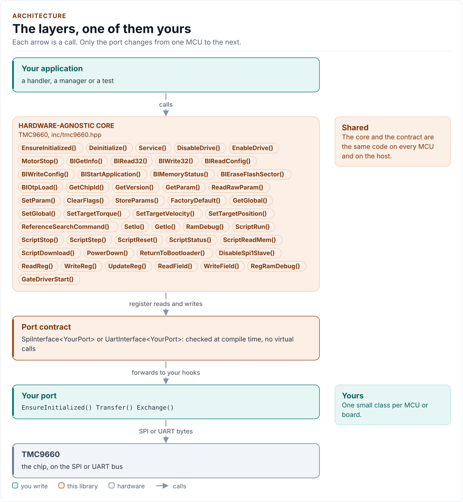

---
hide:
  - navigation
  - toc
---

Driver

# TMC9660 Driver

A C++20 driver for the TMC9660 servo controller and gate driver: the bootloader, parameter mode and register mode,
over SPI or UART, with guards so that nothing energises a motor by accident. It runs on any MCU.

[Quickstart](quickstart.md){ .md-button .md-button--primary }
[API guide](api-guide.md){ .md-button }
[Source on GitHub](https://github.com/kokeb-labs-drivers/driver-tmc9660){ .md-button }

The driver has no platform code. You give it a small class that brings the bus up and moves bytes; it does the
rest: the frames of three protocols, the checks of every reply, the parameter and register tables, and the rules
that keep the power stage off until the chip and your request say otherwise.

<!-- figure: driver-layers -->
<picture>
  <source media="(prefers-color-scheme: dark)" srcset="diagrams/driver-layers.dark.svg">
  
</picture>
<!-- /figure -->

## What you get

- **Three modes in one class.** `Mode::Bootloader`, `Mode::Parameter` and `Mode::Register`; a call that belongs to
  another mode returns `WrongMode` and sends nothing. See [Bootloader](bootloader.md),
  [Parameter mode](parameter-mode.md) and [Register mode](register-mode.md).
- **Checked tables.** All 289 parameters and 163 registers of the reference manuals, with access, range and coded
  values; a bad value is refused before a byte leaves.
- **Safe to start and to stop.** `EnableDrive()` reads the flags and raises DRV_EN before it sets the commutation mode;
  `DisableDrive()` is never refused. See [Safety](safety.md).
- **Reset-aware.** The driver watches each transport for evidence that the chip restarted and sends no write after it.
- **Explicit where the documents disagree.** Twenty-four ambiguities (A1 to A24), most with a knob. See
  [Ambiguities](ambiguities.md).
- **No heap, no exceptions, no RTTI.** The host tests build with `-fno-exceptions -fno-rtti`. See
  [Contract](contract.md).
- **Tested without hardware.** Host tests run the driver against an independent model of the chip, a fuzz target
  attacks it, and one-edit mutants of every guard must be caught. See [Testing and CI](testing.md).

!!! note "Not yet run on a real chip"

    Everything is verified against a model built from the documents. The [ambiguities](ambiguities.md#not-verified)
    page lists what a bench check should settle first.

## Datasheet

<!-- generated: datasheet-card -->
| Document | Revision | Get it |
| --- | --- | --- |
| Datasheet: TMC9660 70V Smart Gate Driver with Servo (FOC) Controller in HW and Buck Converter (Analog Devices (Trinamic) 19-101926) | 1, 2024-11 | [vendor page](https://www.analog.com/en/products/tmc9660.html) |
| Datasheet: TMC9660 Parameter Mode Reference Manual (Analog Devices (Trinamic) n/a) | 0, 2025-02 | [vendor page](https://www.analog.com/en/products/tmc9660.html) |
| Datasheet: TMC9660 Register Mode Reference Manual (Analog Devices (Trinamic) n/a) | 0, 2025-04 | [vendor page](https://www.analog.com/en/products/tmc9660.html) |
| Datasheet: TMC9660 Configuration and Bootstrapping (Analog Devices (Trinamic) AN-2601) | 0, 2025-01-08 | [vendor page](https://www.analog.com/en/products/tmc9660.html) |

Written against these revisions; the SHA-256 of each file is in [`docs/datasheets.yml`](datasheets.yml). Where each part
of the driver is in the datasheet: [Datasheet map](datasheet.md).
<!-- /generated -->

## Where to go next

-   :material-rocket-launch-outline: **[Quickstart](quickstart.md)**

    ---

    Wire the chip, write the port, read a parameter in about 15 lines.

-   :material-chip: **[Hardware](hardware.md)**

    ---

    Pins, bus settings, timing and power.

-   :material-shield-check-outline: **[Safety](safety.md)**

    ---

    What keeps the power stage off, and what the driver does not cover.

-   :material-file-document-check-outline: **[Contract](contract.md)**

    ---

    What the driver promises, what it needs, threading and errors.

-   :material-code-braces: **[API guide](api-guide.md)**

    ---

    Start, configure the bootloader, set parameters, drive, handle errors, task by task.

-   :material-swap-horizontal: **[Porting](porting.md)**

    ---

    Implement the port for your MCU, on SPI or UART.

